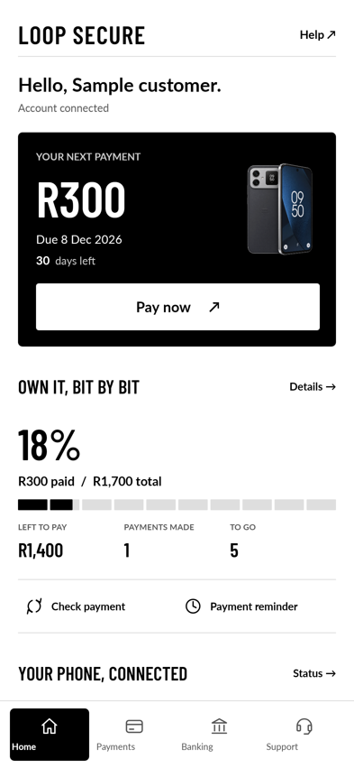

# Customer app 0.21.0

The customer app uses a Swiss grid direction: white, true black, fine rules, compact outlined controls, Lato body text and Barlow Condensed display figures. There is no purple or gold customer theme. Fonts are bundled with OFL licenses; screens do not depend on font downloads.

Home has a clear next-payment block with the phone illustration, a verified repayment percentage, paid/total readings, remaining balance and instalment counts, and separate payment and connection shortcuts. Unknown progress stays unknown. Financial values come from the signed account; neither time remaining nor pending claims count as repayment progress.

Payments groups checkout methods into one entry, separates confirmation/retry from bank transfer actions, and presents claim history as a compact ledger. Record details identify pending/rejected entries and are not represented as confirmed receipts. Bank selection, support, EFT, account details, messages, updates, errors and confirmation panels share a fixed header with independently scrolling content. Device details are readable rows behind a short phone overview.

Five additions:

1. Search installed, approved banks by name; original application icons identify available banks.
2. Keep an unsent support draft locally in the existing encrypted store. Confirmed send clears the draft; closing the panel preserves it.
3. View and copy an individual payment record, including its real recorded state, date and account reference.
4. Open a calendar reminder draft using the verified next payment date. The user saves it in their calendar. No calendar permission is requested. It is unavailable during managed restriction and handles phones without a calendar app.
5. Check provider payment status directly from Home. It uses the existing server verification route and never infers success from a local action.

Install in place over the customer app. Package, release signer and account storage remain unchanged. Existing enrolled clients use their managed update channel where Android permits; installation timing remains dependent on connectivity, active checkout/contact sessions and Android restrictions. There is no firmware or partition modification in this release.

The native admin app and admin website are unchanged in this customer release. Shared native UI source will also be available to a future admin build; the distributed admin APK remains 1.9.0.

Validation: customer release build and lint passed (0 errors; existing localization/platform warnings remain). The full customer test run passed 91 cases, with SDK 30/35 coverage, plus two preview render/navigation cases. A subsequent layout check verifies that the paid/total reading and navigation are visible. No physical handset was connected to this workspace.
