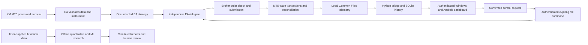

> Update: account-bound live-mode source support was added after the original demo baseline. See [live-mode notes](LIVE_MODE.md). Defaults remain demo; no live broker validation has been performed. Older demo-specific procedures remain the recommended validation path.

# Architecture and authority boundaries

The MQL5 EA owns market-critical decisions, broker validation, order execution, and protective management. Slow analysis, speech, database queries, and web requests are outside its tick path. MT5 is the source of truth for positions and fills; the dashboard is a view and an authenticated request interface.

The Python risk module supplies independently testable risk and state-machine functions. It does not override or replace the EA's final risk gate. Research modules can compare strategies, run chronological tests, and train optional small models. Their outputs do not automatically place orders or deploy a model into the EA. The assistant explains verified records using rules; no paid language-model provider or large local model is required.

## Components

| Component | Location | Responsibility |
|---|---|---|
| Execution EA | `mt5/` | Current ticks, indicators, selected execution strategy, risk approval, orders, protective management, timer-driven bridge. |
| API and authentication | `xmtrader/api.py`, `auth.py` | Authenticated sessions, input validation, rate limits, CSRF, status and control endpoints. |
| Local bridge | `xmtrader/bridge.py` | Validated snapshots, durable event ingestion, expiring command/heartbeat exchange. |
| SQLite storage | `xmtrader/storage.py` | Migrations, broker records, configuration, audits, notifications. |
| Independent risk implementation | `xmtrader/risk.py` | Testable risk decisions and explicit order-state transitions. |
| Research library | `xmtrader/research/` | Indicators, strategies, cost-aware simulated tests, temporal validation, optional ML. |
| Lightweight PWA | `web/` | Responsive dashboard, typed/optional voice interaction, browser alerts, installable shell. |
| Windows and recovery tools | `scripts/` | Private local setup, single-process runner, diagnostics, consistent backups, explicit restore. |

## Local file protocol

The full versioned CSV schema is in [CONTRACT.md](../CONTRACT.md). Both programs run under the same Windows user. The EA writes complete account/position/symbol snapshots using temporary files and replacement; actual trade events carry stable identifiers for deduplication. Order-request events are not treated as executed deals.

The backend writes an expiring command and a random shared secret to the private Common Files folder. EA entries require a fresh authenticated lease. A heartbeat renews that lease; it cannot clear a pause or emergency state. Backend restart and terminal restart require an explicit restart/resume of trading. There are no network requests in the EA's tick handler.

The local user account and filesystem permissions are security boundaries. A malicious process already running as that user can read or alter private files; the shared secret does not defend against a fully compromised Windows session. Use one bridge per intended terminal/account configuration and do not make the folder a network share.

## Data and time

Bridge timestamps are UTC Unix seconds. Native MT5 market/history/calendar timestamps may use broker server time; conversions must remain explicit. Windows clock skew, stale ticks, missing symbol specifications, nonfinite values, or incomplete snapshots must block new entries.

Unknown account values remain null. The dashboard never fills an empty history with sample trades. Historical fixtures and research trades must be labelled simulated and kept out of the broker-execution database.

SQLite backups use SQLite's backup API so committed WAL data is included consistently. A database backup is not a backup of MT5 risk anchors, broker history, terminal configuration, or credentials. Restore requires separate terminal reconciliation.

## Resource budget

The base runtime is one MT5 terminal, one Python API process, SQLite, and a browser. It does not require containers, Node.js, Redis, a GPU, or an always-running ML trainer on the Windows computer. Node.js may be used for developer UI tests but is not a trading runtime dependency.

On the stated Celeron/4 GB machine, begin with a single selected instrument and a small history window. Run research and model training while demo trading is paused. Measure CPU, memory pressure, terminal queue delays, and actual latency before increasing the workload. This hardware has not been benchmarked in the cloud workspace; no throughput or fill-time guarantee is made.

## Important release boundaries

- Live mode requires explicit local account/server pairing in the EA and backend; the dashboard cannot activate that permission.
- A mobile browser cannot keep the Windows EA alive or execute native MT5 EAs.
- The app is not a continuously reachable cloud service; Codex Cloud is for development.
- Network notifications require an active, reachable backend and a supported, permitted browser session. No external push service is configured.
- Native economic-calendar data depends on the terminal/account/service. Unexpected disruptions are not reliably detectable from an unavailable news feed. Fail-closed restrictions are a substitute for missing information, not a claim of comprehensive event coverage.
- Historical or demo performance is evidence about that test period, not proof of future profit.
